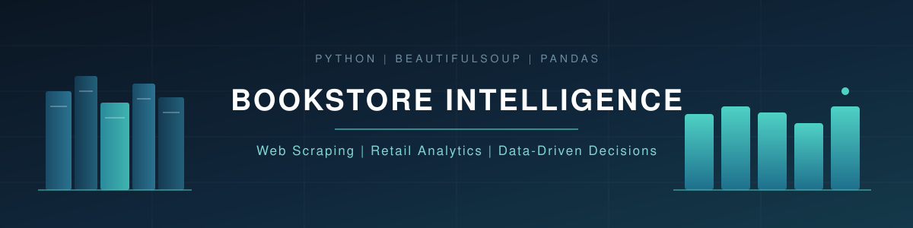

<div align="center">



<br/>


<br/>

[](https://www.python.org/)
[](https://jupyter.org/)
[](https://pandas.pydata.org/)
[](https://numpy.org/)
[](https://www.crummy.com/software/BeautifulSoup/)
[](https://requests.readthedocs.io/)
[](https://matplotlib.org/)
[](#-repository-structure)

</div>

---

## 📖 Introduction

> **What can 1,000 book listings reveal about pricing, ratings, and purchasing decisions?**

This project converts an online book catalogue into structured datasets and applies Python-based analysis, visualisation, and optimisation to it. Starting from raw HTML on [Books to Scrape](https://books.toscrape.com/), it builds a small competitive-intelligence workflow for a hypothetical bookstore: scrape the catalogue, structure it with Pandas, analyse prices and ratings, and use dynamic programming to choose the best books for a fixed budget.

---

## 📊 Results Dashboard

<div align="center">

| 📚 Main Dataset | 🗄️ Full Catalogue | 📄 Pages Scraped | ⭐ Five-Star Books |
|:---:|:---:|:---:|:---:|
| **60** books | **1,000** books | **50** pages | **14** of 60 |

| 🧮 Books Selected | 💷 Total Cost | 🏆 Rating Score | 💰 Budget Left |
|:---:|:---:|:---:|:---:|
| **6** books | **£96.59** | **26** stars | **£3.41** of £100 |

</div>

> ⚠️ **Note:** Books to Scrape assigns ratings at random. These figures are results of an analytical exercise, not evidence of real customer sentiment.

---

## 🧭 Project Overview

```text
Inspect HTML  →  Extract Data  →  Scrape Pages  →  Structure with Pandas
        →  Analyse Prices & Ratings  →  Solve Budget Problem  →  Visualise Ratings
```

| Step | What happens |
|:---:|---|
| **1** | Inspect the website's HTML to find the right selectors |
| **2** | Extract book information (title, price, rating, availability) |
| **3** | Collect records across catalogue pages |
| **4** | Structure the data into Pandas DataFrames |
| **5** | Analyse prices, ratings, and availability |
| **6** | Solve the budget-constrained selection problem |
| **7** | Visualise the full-catalogue rating distribution |

---

## 📈 Data Visualisation

<div align="center">

.png)

*Distribution of star ratings across the 1,000-book full catalogue.*

| Rating | ⭐ | ⭐⭐ | ⭐⭐⭐ | ⭐⭐⭐⭐ | ⭐⭐⭐⭐⭐ |
|:---:|:---:|:---:|:---:|:---:|:---:|
| **Books** | 226 | 196 | 203 | 179 | 196 |

</div>

**Interpretation:** the scraped catalogue is spread fairly evenly across the five rating categories, with no single rating dominating. This describes the practice dataset only, and the ratings should not be read as genuine customer satisfaction or market demand.

---

## ✨ Key Features

| Feature | Practical purpose |
|---|---|
| 🔍 **HTML inspection & selector identification** | Locates the exact elements that hold each data field |
| 🌐 **Multi-page web scraping** | Collects records across the catalogue rather than a single page |
| 🗂️ **Structured data extraction** | Turns unstructured web content into tabular records |
| 💾 **CSV export** | Saves datasets for reuse and reproducibility |
| 💷 **Price & rating analysis** | Summarises the catalogue with descriptive statistics |
| ⭐ **Five-star filtering & price ranking** | Identifies the cheapest top-rated books |
| 📊 **Rating distribution analysis** | Counts books in each rating category |
| 📉 **Bar chart generation** | Presents the distribution visually with Matplotlib |
| 🧮 **£100 budget selection (dynamic programming)** | Maximises combined star rating within a budget |
| 🔗 **Full-catalogue scraping with product URLs** | Extends collection to 1,000 books with links back to each product |

---

## 🔎 Analytical Findings

Findings below are from the 60-book main dataset (`competitor_books.csv`).

| # | Question | Finding | Business relevance |
|:---:|---|---|---|
| 1 | Most expensive book? | *Slow States of Collapse: Poems* — **£57.31** | Sets the top of the price range |
| 2 | Cheapest book? | *In Her Wake* — **£12.84** | Sets the bottom of the price range |
| 3 | Average price? | **£35.00** | Baseline for price positioning |
| 4 | Five-star share? | **14 of 60** (≈ 23.3%) | Size of the top-rated segment |
| 5 | In-stock share? | **100%** of the dataset | No availability constraint in this sample |
| 6 | Top five by rating (lower price breaks ties)? | *Sophie's World*, *Thirst*, *Set Me Free*, *The Four Agreements: A Practical Guide to Personal Freedom*, *#HigherSelfie: Wake Up Your Life. Free Your Soul. Find Your Tribe.* | Shortlist of top-rated, lower-cost titles |
| 7 | Cheapest five-star book? | *Sophie's World* — **£15.94** | Lowest-cost entry among top-rated books |

---

## 💼 Business Recommendation

For a hypothetical competing bookstore, the five-star analysis supports a preliminary catalogue selection: the five cheapest five-star books in the main dataset.

<div align="center">

| Book | Price |
|---|---:|
| Sophie's World | £15.94 |
| Thirst | £17.27 |
| Set Me Free | £17.46 |
| The Four Agreements: A Practical Guide to Personal Freedom | £17.66 |
| #HigherSelfie: Wake Up Your Life. Free Your Soul. Find Your Tribe. | £23.11 |
| **Total** | **£91.44** |

</div>

This is a **preliminary price-based comparison, not a validated sales forecast**. The dataset contains no sales, customer-demand, or profit-margin data.

---

## 🎯 The £100 CEO Challenge

The task: choose books to **maximise the sum of star ratings without exceeding £100**. This is a classic **0/1 knapsack** problem, solved with **dynamic programming**, which evaluates affordable combinations systematically instead of relying on a greedy guess.

<div align="center">

| 🧮 Books Selected | 💷 Total Price | 🏆 Combined Rating | 💰 Budget Remaining |
|:---:|:---:|:---:|:---:|
| **6** | **£96.59** | **26** | **£3.41** |

</div>

It is a useful demonstration of constrained decision-making. The objective is rating-based only and does not account for real demand, margins, shipping, or customer preferences.

---

## 📁 Repository Structure

| File | Purpose |
|---|---|
| `Bookstore_Intelligence_Notebook.ipynb` | Main notebook containing scraping, analysis, and optimisation |
| `competitor_books.csv` | Original 60-record dataset |
| `competitor_books_bonus.csv` | Extended 1,000-record dataset with product URLs |
| `five_star_books_by_price.csv` | Five-star books from the main dataset, sorted by price |
| `rating_counts.csv` | Count of books in each rating category |
| `book_rating_distribution.png` | Rating-distribution bar chart |
| `project_banner.svg` | README banner graphic |
| `requirements.txt` | Python dependencies for reproducing the project |
| `README.md` | Project documentation |

---

## ⚙️ Installation & Usage

**1. Clone the portfolio repository**

```bash
git clone https://github.com/rayyan-builds/Decision-Intelligence-Portfolio.git
```

**2. Navigate to the project folder (Windows)**

```powershell
cd "Decision-Intelligence-Portfolio\01-Data Analytics\Bookstore-Intelligence-Web-Scraper"
```

**3. Install dependencies**

```bash
python -m pip install -r requirements.txt
```

**4. Launch Jupyter**

```bash
python -m notebook
```

Open `Bookstore_Intelligence_Notebook.ipynb` and run the cells in order. An internet connection is required for the web-scraping steps, and outputs may be regenerated when the notebook is rerun.

---

## 🧪 Limitations & Data Integrity

Being explicit about what the data can and cannot support is part of the analysis:

- **Books to Scrape is a practice website** built for learning web scraping.
- **Ratings are randomly assigned**, so they carry no real customer signal.
- **No sales or demand data** is available.
- **Price and availability** reflect the data collected at scraping time.
- **Website structure may change**, which would require updating the scraping code.
- **The budget optimisation** maximises a defined rating-based objective, not real-world commercial value.

---

## 🧠 Skills Demonstrated


---

<div align="center">

## 👤 Author

**Rayyan Asim**
BS Business Analytics — FAST-NUCES Islamabad

[](https://github.com/rayyan-builds/Decision-Intelligence-Portfolio)
[](https://github.com/rayyan-builds/Decision-Intelligence-Portfolio/tree/main/01-Data%20Analytics/Bookstore-Intelligence-Web-Scraper)
[](https://www.linkedin.com/in/rayyan-asim-096877252)


</div>
